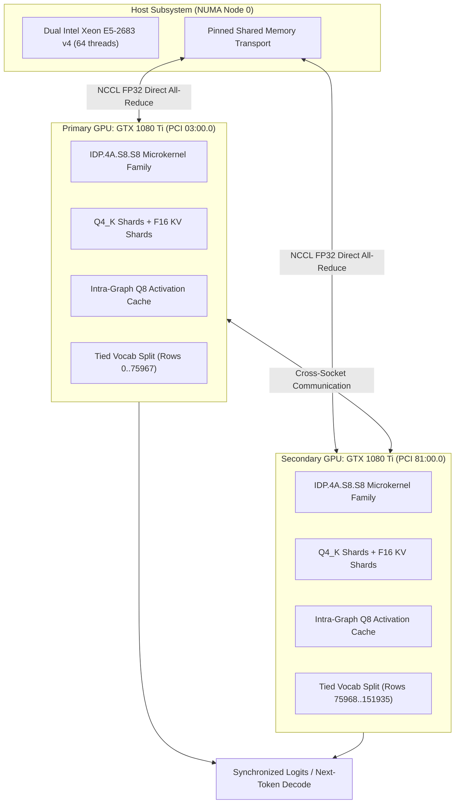

# Abra: High-Performance LLM Inference on Legacy GPUs

[](LICENSE)
[](https://developer.nvidia.com/cuda-toolkit)
[-orange.svg)](https://www.nvidia.com)
[-brightgreen.svg)]()

> High-throughput LLM inference engine optimized for NVIDIA Pascal (`sm_61`, e.g., GTX 1080 Ti / 1060). Implements custom DP4A SIMD microkernels, autotuned matrix-vector families, and dual-GPU NCCL tensor parallelism.

---

## Summary

* **The Problem:** Modern LLM runtimes (vLLM, TensorRT-LLM) optimize heavily for Tensor Core architectures (Volta/Ampere/Hopper). On legacy Pascal GPUs, quantized GEMV decode workloads suffer from thread divergence, high register pressure, and slow fallback emulation.
* **The Fix:** Abra bypasses scalar emulations by synthesizing hardware `IDP.4A.S8.S8` vector dot products, autotuning a 17-variant parameterized warp family to maintain 100% theoretical occupancy with zero register spills, and splitting vocabulary projections across dual cards via socket-aware NCCL.
* **The Result:** **115.4 tokens/s decode** on Dual GTX 1080 Ti (Qwen3-4B Q4_K_M)—a **+44% throughput speedup** over single-GPU stock inference with bit-identical logit validation.

---

## Performance (Qwen3-4B Q4_K_M, Dual GTX 1080 Ti)

*Measured across 20-sample balanced blocks with dynamic thermal/clock monitoring on dual Xeon E5-2683 v4 (64 threads):*

### Decode Throughput (tg128)

| Context Depth | Single GTX 1080 Ti (Stock) | Dual GTX 1080 Ti (Stock NCCL) | **Dual GTX 1080 Ti (Abra)** | **Throughput Gain vs Single** |
| :---: | :---: | :---: | :---: | :---: |
| **0 Context** | 80.1 t/s | 105.4 t/s | **115.4 tokens/s** | **+44.0%** |
| **2048 (2K)** | 72.2 t/s | 94.2 t/s | **102.5 tokens/s** | **+42.0%** |
| **8192 (8K)** | 60.8 t/s | 80.6 t/s | **86.9 tokens/s** | **+43.0%** |

* **Prompt Processing (pp512):** **2,363 tokens/s** (depth 0) and **1,045 tokens/s** (depth 8K).
* **VRAM Overhead:** Saved **152 MiB VRAM peak per GPU** via intra-graph activation quantization reuse.
* **Speculative Code Copying:** **293.0 tokens/s** ($4.07\times$ speedup) via greedy prompt lookup with bit-exact token IDs.
* **Numerical Quality:** All **14,585,856** sampled logits bit-identical to reference; WikiText-2 perplexity $\Delta < +0.19\%$; 756/756 oracle correctness tests passed.

---

## Quick Start

### 1. Build repo

```bash
# Clone repository
git clone https://github.com/talystalys/abra.git
cd abra

# Fetch pinned NCCL 2.27 locally & compile optimized Pascal runtime
python3 tools/fetch-nccl.py
python3 tools/build-port.py --profile --reuse-q8 --split-tied-output --nccl-prefix .deps/nccl-2.27.7-cuda12
```

### 2. Run inference

Download `Qwen3-4B-Q4_K_M.gguf` to `models/` (or pass via `--model`):

```bash
# Dual-GPU inference (Default: NCCL FP32 + Output Split + Q8 Reuse)
python3 tools/qwen3-4b.py -p "Explain GPU warp divergence." -n 128

# Single-GPU fallback (Secondary GPU)
python3 tools/qwen3-4b.py --runtime flash --gpu secondary -p "Hello world!"
```

---

## Architecture



### 1. Hardware SIMD DP4A Microkernels (`IDP.4A.S8.S8`)
Pascal `sm_61` lacks Tensor Cores but features hardware integer dot-product vector instructions. Abra executes vectorized 128-bit loads (`int4`), feeding 4-element signed 8-bit integer dot products directly into hardware accumulators:
$$\text{acc} \leftarrow \text{acc} + \sum_{i=0}^3 A_i \cdot B_i$$
SASS assembly verification confirms $0$ scalar integer multiply-adds and active emission of hardware `IDP.4A.S8.S8`, yielding a **$2.60\times\text{--}3.64\times$ microkernel compute speedup**.

### 2. Parameterized $Q4\_K \times Q8\_1$ Kernel Family & Autotuning
The decoding matrix-vector (`MMVQ`) kernel is parameterized across a 17-variant candidate space:
* **Warps-Per-Row ($\text{WPR} \in \{1, 2, 4\}$):** $\text{WPR}=1$ utilizes 0 bytes shared memory with intra-warp shuffle reduction (`__shfl_down_sync`), achieving **100% theoretical occupancy** (64 resident warps/SM on GP102). $\text{WPR} \in \{2, 4\}$ utilizes cross-warp shared-memory stages.
* **Zero Register Spills:** Compiled strictly to $32\text{--}40$ registers per thread, eliminating local memory spills.
* **Deadlock-Free Boundary Predication:** Non-boundary warps participate in `__syncthreads()` unconditionally, preventing thread divergence lockups on arbitrary matrix dimensions ($N$).
* **Aggregate Impact:** **$+9.2\%$ latency reduction** ($1.101\times$ speedup) across all 216 model layers in Qwen3-4B.

### 3. Dual-GPU NCCL Tensor Parallelism & Vocabulary Row Splitting
* **NCCL FP32 All-Reduce:** Shards weights and KV caches across dual cards over separate CPU sockets without requiring NVLink.
* **Tied Output Vocabulary Splitting:** Qwen3-4B ties embedding weights (`token_embd.weight`) with vocabulary output projection ($2560 \times 151936$). Abra partitions the output projection by vocabulary rows across GPUs while preserving the input lookup embedding, eliminating duplicate output GEMVs.
* **Intra-Graph Q8 Activation Reuse:** Caches quantized $Q8\_1$ activations across multiple linear projection branches within a computational graph, eliminating redundant conversions and saving **152 MiB VRAM per card**.

---

## Verification & Correctness

Abra enforces strict verification gates before declaring any benchmark valid:
* **Logit Equivalence:** 14,585,856 consecutive model logits verified bit-identical to reference outputs.
* **Oracle Correctness:** 756 / 756 CPU reference tests pass across synthetic distributions, boundary cases, and real model weights.
* **Language Modeling Perplexity:** WikiText-2 score of `12.4064` (+0.19% $\Delta$, strictly within the 1% target envelope).
* **Thermal Telemetry:** Dynamic clock and thermal throttling (up to 91°C) logged continuously to guarantee reproducible hardware states.

---

## License

Licensed under the [MIT License](LICENSE).
