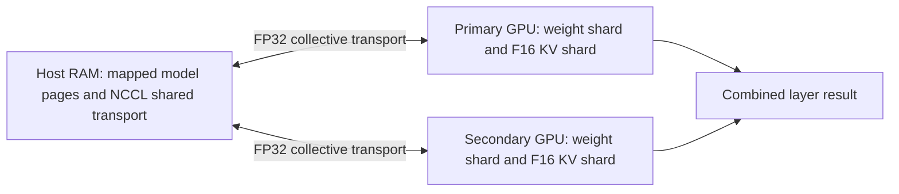

# Further Qwen3-4B optimization on BigBoy

This round implements and measures further acceleration beyond the first
port's single-GPU Flash Attention configuration. Work remains on branch
`port/1080ti-runtime` and the isolated BigBoy checkout
`/home/taly/abra-1080ti-port`. The original research checkouts are preserved.

## Hardware and fixed conditions

BigBoy has two GTX 1080 Ti cards (Pascal, CC 6.1, 11 GiB each):

| Role | PCI | UUID |
| --- | --- | --- |
| Primary | `0000:03:00.0` | `GPU-3007f159-e0cf-9303-0a81-41ea8e945315` |
| Secondary | `0000:81:00.0` | `GPU-00279cb0-a4dc-86ec-7aa2-223d35376e6c` |

Driver 550.163.01, CUDA 12.9 (nvcc V12.9.86), dual Xeon E5-2683 v4,
62.77 GiB RAM. GPUs communicate across CPU sockets (`SYS` topology).
Dynamic clocks and existing power limits (250 W primary, 280 W secondary)
are unchanged. Historical GTX 1060/1660 measurements are separate.

The immutable Qwen3-4B Q4_K_M model has SHA256
`7485fe6f11af29433bc51cab58009521f205840f5b4ae3a32fa7f92e8534fdf5`.
Runtime source stays pinned to `169e4a7ff201e666c2325bcd35afb64573e39d09`.
Selected configurations retain F16 KV, all 37 layers offloaded, Flash
Attention enabled, four CPU threads, batch 2048 and microbatch 512.
Single-GPU baseline uses the secondary GPU with NUMA node 1 binding;
tensor configurations use both GPU UUIDs, equal splitting and node 0 binding.
Custom kernels, prepacking, diagnostic profiling and CUDA graphs are disabled
in these throughput comparisons.

## Implemented changes

- Added UUID-bound tensor mode to the launcher and experimental tools.
- Extracted NVIDIA NCCL 2.27.7 for CUDA 12.9 into `.deps`; no system package,
  driver, power, fan or service changes. Packages are checked against NVIDIA's
  repository SHA256 records. The library includes native `sm_61` cubins.
- Patched Pascal NCCL reductions to retain FP32 at every collective size.
  Upstream's large-tensor heuristic otherwise converts reductions to BF16.
  NCCL compile definitions are scoped to the communication translation unit;
  Makefile dependency regeneration still caused CUDA objects to rebuild.
- Preserved the original runtime binaries in `build-port-no-nccl` and recorded
  their hashes before rebuilding.
- Implemented one-model greedy prompt lookup, batched target verification,
  explicit KV rollback on rejection, and ordinary decoding when no match
  exists. Added a batch launcher, finite-logit checks, token-ID comparisons,
  RSS/GPU-memory telemetry and verification-block latency arrays.
- Extended reproducible benchmarks to cover CPU layers, CPU KV, quantized
  caches, tensor splitting and explicit collective implementations.

The selected execution path splits each supported tensor across the cards:



This diagram describes tensor communication; it does not imply full weights
are streamed from host RAM for each token.

## Research that drove the experiments

[NVIDIA's Pascal guide](https://docs.nvidia.com/cuda/pascal-tuning-guide/index.html)
motivates reducing memory traffic and launch costs. The existing runtime's
[speculation documentation](https://github.com/ggml-org/llama.cpp/blob/169e4a7ff201e666c2325bcd35afb64573e39d09/docs/speculative.md)
and [speculative decoding paper](https://arxiv.org/abs/2211.17192) motivate
reusing repeated context to batch target verification without a draft model.
The implementation here is greedy only; it does not implement stochastic
rejection sampling or claim universal equality under differing GPU numerics.

The [pinned multi-GPU guide](https://github.com/ggml-org/llama.cpp/blob/169e4a7ff201e666c2325bcd35afb64573e39d09/docs/multi-gpu.md)
identifies tensor splitting and NCCL as acceleration options. Its restrictions
include nonquantized KV and no backend sampling in tensor mode. The
[NCCL 2.27 installation guide](https://docs.nvidia.com/deeplearning/nccl/archives/nccl_2275/install-guide/index.html)
lists Pascal-compatible hardware requirements; native cubins and actual
initialization are additionally checked here.

[NVIDIA's oversubscription study](https://developer.nvidia.com/blog/improving-gpu-memory-oversubscription-performance/)
shows why memory placement and access patterns matter for spilling to RAM.
[FlexGen](https://arxiv.org/abs/2303.06865) explores placement and batching for
throughput. [KIVI](https://arxiv.org/abs/2402.02750) motivates asymmetric KV
quantization as further research. This round tests existing GGML Q8/Q4 caches,
not KIVI's algorithm. No automatic Unified Memory spill engine was added:
explicit placement already establishes the costs for this model and machine.

## Quality and frozen comparisons

The single-GPU versus tensor strict comparison **failed**: maximum absolute
logit difference 2.2966793776, RMS 0.1911715604, and 4,817,697 tolerance
violations among 4,861,952 logits at depth 2048. Its 32 greedy tokens matched.
This remains a failure under the frozen `0.001 + 0.0001 * abs(reference)`
envelope. Tensor mode also diverged on longer prose/reasoning sequences in
the exploratory decoding harness. It is qualified through the separately
specified fixed-corpus/task criterion, not declared numerically identical to
single-GPU inference.

Both the preserved butterfly tensor path and the NCCL FP32 tensor path
completed the same 20 WikiText-2 chunks (40,960 input tokens; 20,460 scored
predictions) and ten fixed task probes:

| Configuration | Perplexity | Task successes |
| --- | --- | --- |
| Single GPU, F16 Flash Attention | 12.3824 ± 0.29075 | 8/10 |
| Tensor split, butterfly | 12.4064 ± 0.29175 | 8/10 |
| Tensor split, NCCL FP32 | 12.4064 ± 0.29175 | 8/10 |

The frozen task scorer normalizes case/trailing punctuation and parses JSON;
the formatting failures still do not count as successes.

Relative perplexity change is **+0.193823%**, below the predeclared 1% limit,
with no lost baseline successes. The same sum/code formatting failures remain.
Twenty corpus chunks and ten probes do not establish equal quality on every
workload, larger context or stochastic decoding setting.

The custom NCCL FP32 path matched pinned upstream tensor logits **bit for
bit** at depths 0, 2048 and 8192, 32 greedy steps each, covering 14,585,856
finite logits. Original comparator tolerances and custom kernel oracles remain
unchanged. Untimed NCCL INFO logs prove the pinned library initialized;
verbose logging is absent from timed runs.

Evidence: `tensor-strict-single-reference`, `tensor-quality-butterfly`,
`tensor-quality-nccl`, `nccl-strict-tensor-reference` beneath
`bench/results/1080ti-port/`.

## Exploratory RAM/cache results

These are three measured decode samples after one excluded workload sample,
128 generated tokens, no timed prompt processing, following upstream's
normal warmup. They are screens, not final speed claims. The brief first
placement and lookup screens ran on separate GPUs/NUMA nodes concurrently;
final comparisons are serialized with compilation and other GPU work absent.

| Placement/cache | 2K tokens/s | 8K tokens/s | Peak secondary VRAM at 8K |
| --- | ---: | ---: | ---: |
| Single GPU, F16 | 74.78 | 62.81 | 4039 MiB |
| Q8 KV | 69.04 | 55.35 | 3483 MiB |
| Q4 KV | 67.62 | 54.16 | 3187 MiB |
| CPU KV | 14.84 | 5.14 | 2851 MiB |
| 32 GPU layers, 16 CPU threads | 33.03 | 22.50 | 3579 MiB |
| 24 GPU layers, 16 CPU threads | 18.19 | 12.40 | 2861 MiB |

VRAM peaks include the model and runtime, not just cache bytes. The model's
mapped host pages are present even with full GPU offload, so RSS is not a
simple measure of exclusively offloaded weights. CPU placement saves VRAM
but substantially slows this dense model. Quantized KV changes cache precision
and has not been promoted or quality-qualified here. Its smaller footprint
may still be useful on a smaller card or at larger context.

Four/eight/one CPU thread screens gave no material generation improvement.
Backend greedy sampling alone gave no material gain and added roughly
298 MiB of reserved GPU buffers in the short-context screen.

## Prompt lookup: experimental outcome

At a 512-token output cap, the first screens matched baseline token IDs for
repeated code copying and editing, with approximately 3.5–3.9× throughput.
Prose diverged at token 203; a seven-token draft also failed prose equality.
Reasoning often proposed incorrect continuations and gained little speed.
The exact-token criterion therefore **failed** for general use. The mode
remains an explicit research launcher and is not the default chat path.

The first combined lookup/backend-sampling run failed because the upstream
context defaults to one backend output per sequence. Setting the actual
verification-block output limit fixed that setup issue; the failed raw run
remains in `lookup-screen-primary`. It did not fix prose token divergence.

Latency arrays record whole verification blocks. Several accepted tokens can
arrive together after a 35–50 ms block; this must not be represented as an
individual-token p95 by dividing block latency by the accepted count.

## Final sustained measurements

Each configuration/depth has 20 measured samples: two blocks in forward and
reverse configuration order, each with five excluded full-workload warmups
and ten measured samples. Upstream also performs its normal warmup. There
was no other GPU workload or compilation during these runs. Prompt rows
process 512 new tokens after the stated history; decode rows generate 128
tokens after that history. `llama-bench` uses synthetic token histories;
these are runtime measurements, separate from the real task/corpus checks.

| History | Mode | Decode median | Min | Max | Spread | Gain vs single |
| --- | --- | ---: | ---: | ---: | ---: | ---: |
| 0 | Single GPU | 80.123 | 77.859 | 80.568 | 2.709 | +0.00% |
| 0 | Two GPUs, butterfly | 87.979 | 83.830 | 92.035 | 8.205 | +9.80% |
| 0 | Two GPUs, NCCL FP32 | 99.621 | 95.811 | 105.038 | 9.227 | +24.33% |
| 2048 | Single GPU | 72.184 | 70.308 | 73.271 | 2.963 | +0.00% |
| 2048 | Two GPUs, butterfly | 82.698 | 79.246 | 86.545 | 7.299 | +14.57% |
| 2048 | Two GPUs, NCCL FP32 | 94.095 | 89.628 | 96.893 | 7.265 | +30.35% |
| 8192 | Single GPU | 60.794 | 59.486 | 61.739 | 2.253 | +0.00% |
| 8192 | Two GPUs, butterfly | 72.304 | 71.163 | 76.615 | 5.452 | +18.93% |
| 8192 | Two GPUs, NCCL FP32 | 82.535 | 80.029 | 85.664 | 5.635 | +35.76% |

All rates are tokens/s. Prompt processing:

| History | Mode | Prompt median | Min | Max | Spread | Gain vs single |
| --- | --- | ---: | ---: | ---: | ---: | ---: |
| 0 | Single GPU | 1696.806 | 1679.793 | 1714.548 | 34.755 | +0.00% |
| 0 | Two GPUs, butterfly | 2003.588 | 1986.207 | 2014.603 | 28.396 | +18.08% |
| 0 | Two GPUs, NCCL FP32 | 2339.903 | 2324.143 | 2349.728 | 25.585 | +37.90% |
| 2048 | Single GPU | 1193.558 | 1186.864 | 1198.950 | 12.086 | +0.00% |
| 2048 | Two GPUs, butterfly | 1554.107 | 1438.779 | 1608.416 | 169.637 | +30.21% |
| 2048 | Two GPUs, NCCL FP32 | 1799.522 | 1745.301 | 1810.088 | 64.787 | +50.77% |
| 8192 | Single GPU | 645.103 | 631.382 | 649.178 | 17.797 | +0.00% |
| 8192 | Two GPUs, butterfly | 950.781 | 885.132 | 1020.224 | 135.092 | +47.38% |
| 8192 | Two GPUs, NCCL FP32 | 1047.374 | 253.283 | 1079.835 | 826.552 | +62.36% |

Raw evidence and aggregate:
[final-tensor-nccl](../../bench/results/1080ti-port/final-tensor-nccl/report.json).
Every sample is retained, including the 253.283 tokens/s 8K NCCL prompt
outlier. Short-screen peaks are not substituted for sustained results.

NCCL additionally improves decode over butterfly by about 13–14% in these
balanced runs. At 2K, measured peak allocation was 3211 MiB on the single
card versus 2049 MiB **per card** with NCCL; at 8K, 4075 versus 2481 MiB
per card. Splitting reduces per-card memory while using more total GPU
memory. Telemetry includes initialization, warmups and both prompt/decode
rows. The primary reached 91°C during the 8K blocks. Its clock briefly fell
to 265 MHz in the block containing the prompt outlier; temperature/clock
correlation alone does not prove the cause of that one sample.

The default launcher now selects two GPUs, equal tensor splitting, NCCL
FP32, upstream Flash Attention and F16 KV. It refuses NCCL mode when the
linked library is absent. `--runtime flash --gpu secondary` retains the
single-card configuration; `--runtime exact --gpu secondary` retains the
previous exact-order custom attention option. System settings are unchanged.

## Unequal splitting screen

The predeclared thermal hypothesis tested 4:5, 2:3 and 3:5 proportions,
bracketed by fresh 1:1 controls at 2K. Each used five excluded full samples
and five measured samples, 128 generated tokens, NCCL and F16 FA. Medians:
1:1 before 97.717, 4:5 91.700, 2:3 89.451, 3:5 88.046, 1:1 after
93.962 tokens/s. None exceeded the mean bracketing control (95.839), let
alone the required 5% improvement. Equal splitting remains selected. These
are exploratory comparisons with dynamic thermal drift, not final ratios.
[Raw screen](../../bench/results/1080ti-port/thermal-split-screen/selection.json).

## RAM placement latency and repeatability

Eight requests per mode, no excluded warmup requests, the same 36-token prose
prompt and 256-token output cap. This short-context workload differs from
the synthetic 2K/8K placement screen. All blocks emit one token, so these
whole-block p95 values represent the measured token decode loop (not full
request or time-to-first-token latency). Prefill and model loading are excluded
from decode rates. Modes ran sequentially; this is a characterization, not a
balanced 20-sample candidate speed claim.

| Mode | Median t/s | Min | Max | Spread | p95 ms | GPU peak MiB | Late RSS MiB | Same IDs as baseline |
| --- | ---: | ---: | ---: | ---: | ---: | ---: | ---: | --- |
| baseline | 78.975 | 78.843 | 79.323 | 0.479 | 12.861 | 2945 | 703.3 | Yes |
| cpu-kv | 42.682 | 42.455 | 42.949 | 0.494 | 31.116 | 2837 | 810.7 | Yes |
| layers24 | 21.315 | 21.157 | 21.443 | 0.286 | 48.418 | 2157 | 1497.4 | No |
| layers32 | 39.204 | 39.134 | 39.292 | 0.158 | 26.191 | 2641 | 1019.5 | No |
| q8 | 73.800 | 73.727 | 74.107 | 0.380 | 13.764 | 2895 | 710.8 | No |

All eight repetitions within every mode produced identical IDs, and the
ordinary greedy path checked every vocabulary logit for finiteness. No sampled
process swap was observed. CPU KV matched the GPU baseline here; CPU layers
and Q8 cache changed token sequences. None has been quality-qualified for
promotion. The maximum observed single block was 50.938 ms with 24 GPU layers.

Late RSS is the median of sampled process RSS in the final 10% of each run,
including mapped pages still resident; it is not an exclusive weight byte
count. Initial model-loading maximum RSS was about 2.66 GiB in every mode.
These short repeated tests support repeatability on this workload, not a
claim of long-term production stability or memory pressure tolerance.
[Raw latency and memory arrays](../../bench/results/1080ti-port/ram-placement-latency/combined-report.json).

## Complete-code lookup comparison

The workload asks for all 24 provided Python functions without markdown or
explanation. The 2048-token limit allows completion; all configurations ended
naturally after **531 generated tokens**. Every repetition returned all 24
functions exactly and matched baseline token IDs. Same greedy verifier,
F16 KV and immutable model; two GPUs use NCCL FP32. Five request warmups per
block were excluded; forward/reverse blocks provide 20 measured requests
per configuration. Model loading and prompt prefill are excluded from decode
rates, as in the main throughput measurements.

| Mode | Median tokens/s | Min | Max | Spread | p95 block ms | Max block ms |
| --- | ---: | ---: | ---: | ---: | ---: | ---: |
| Single GPU | 72.039 | 71.361 | 76.111 | 4.751 | 14.178 | 15.337 |
| Two GPUs, ordinary | 90.004 | 73.150 | 96.109 | 22.958 | 13.938 | 31.140 |
| Two GPUs, lookup | 293.018 | 287.958 | 310.436 | 22.478 | 40.897 | 50.089 |

Lookup is **4.067×** the single-card baseline and **3.256×** ordinary tensor
inference on this particular complete-copy task. Acceptance was 9520/16960
proposed tokens (56.13%) across measured requests. The higher whole-block
p95 reflects several tokens arriving together; ordinary modes have one token
per block. It does not mean individual-token p95 is 40.897 ms or that lookup
has lower pause latency.

Peak sampled VRAM was 3283 MiB on the single card or 2085 MiB per card for
both two-GPU modes. Maximum RSS, including load, was 2786864/2907672/2906112
KiB respectively. Later sampled RSS was much smaller as mapped model pages
were reclaimed. RSS is not exclusively offloaded model memory.

The full editing screen also returned all 24 functions with every `* 2`
changed to `* 3`, with identical IDs. Its three measured medians after one
excluded request were 72.554 single, 91.084 tensor and 308.298 tensor lookup
(tokens/s). That remains an exploratory edit result, not a 20-sample claim.
General prose/reasoning token failures remain unchanged; this does not qualify
lookup as a universal replacement for normal chat.

[Balanced full-copy evidence](../../bench/results/1080ti-port/lookup-complete-code-final/combined-report.json),
[full-copy/edit screen](../../bench/results/1080ti-port/lookup-complete-code-screen/combined-report.json).

The separate ten-probe decoding check returned matching baseline token IDs
for single lookup, ordinary tensor and tensor lookup on every fixture, with
9/10 successes in each under the existing qualification scorer (case and
trailing punctuation normalized), or 8/10 under additional literal matching.
The literal extra failure is `No.` versus `no`; the canonical failure is the
verbose sum answer. This separate harness uses prompt-sized context capacity
and produced a concise correct code-trace answer, unlike the 2048-capacity
completion qualification. Scores from these different settings are not merged.
This is one request per mode/fixture,
not a throughput benchmark. Short-output startup/block costs can make tensor
or lookup slower on individual one-token tasks; long decode medians do not
promise faster answers to every prompt. The independent longer prose and
reasoning mismatches still exclude general lookup qualification.
[Probe evidence](../../bench/results/1080ti-port/lookup-fixed-probes/combined-report.json).

## Repeated-request NCCL soak

The same prose prompt was decoded in one persistent model/context allocation
for **100 requests and 25,600 generated tokens**, clearing KV metadata between
requests. No request warmups were excluded. All outputs repeated exactly,
with finite full-vocabulary logits at every ordinary greedy selection. This
is a short reset-context soak, not a continuously growing-context test or
production reliability certification.

Median decode was 92.486 tokens/s, min 67.994, max 101.906, spread 33.912.
Token-block p95 was 14.370 ms; maximum 30.180 ms. Peak GPU memory was
1907 MiB on each card. In the 20–90% telemetry window, both cards remained
at 1907 MiB. Sampled host RSS medians were 1150344 KiB in the 20–30% time
window and 1150348 KiB in the final 10%; maximum observed process swap was
zero. Loading-inclusive maximum RSS was 2907904 KiB. The primary reached
91°C and speed varied, so repeatability does not imply constant latency.

[Request/latency evidence](../../bench/results/1080ti-port/nccl-repeat-soak/combined-report.json),
[allocation window](../../bench/results/1080ti-port/nccl-repeat-soak/stability-window.json).

## Regression and launcher checks

The unchanged oracle suites completed on both physically identified cards:
756 Q4_K family cases, 2025 Q4_K/Q6_K runtime kernel cases, 90 QK attention
cases and 48 value cases **per card** (5838 total). Existing double-oracle
envelopes and upstream bit comparisons are unchanged.
[Commands and binary hashes](../../bench/results/1080ti-port/next-oracles/commands.json).

Actual launcher smokes exercised default two-GPU chat and completion,
single-GPU Flash Attention completion, both-GPU experimental lookup and
single-GPU ordinary batch decoding. Expected answers were `391` and `Paris`;
invalid GPU combinations and existing output files were also rejected.
The initial smoke used an invalid `--no-cnv` spelling for the pinned
completion binary. Correcting it to the supported `-no-cnv` and handling the
program's `[end of text]` marker produced successful checks. Both the original
failed invocation and the corrected run are retained.
[Corrected smokes](../../bench/results/1080ti-port/next-launcher-smokes-v2/report.json).

The supplemental probes-only comparison at the launcher's actual **4096**
context capacity also scored 8/10 in both modes with no lost baseline
successes. It supplements the original 20-chunk, 2048-capacity perplexity
qualification; no 4096-capacity perplexity result is implied.
[Launcher context probes](../../bench/results/1080ti-port/tensor-launcher-quality-4096/quality.json).

A second build completed successfully and reproduced all 22 recorded runtime
libraries, executables and validation binaries byte for byte. After rebuilding,
the single-card fallback and exact QK/value combinations matched original
upstream logits bit for bit at depths 0 and 2048 (eight comparisons, 32 steps
each). No comparison tolerance changed.
[Rebuild hashes](../../bench/results/1080ti-port/next-rebuild-audit/report.json),
[exact runtime checks](../../bench/results/1080ti-port/next-exact-runtime-validation/summary.json).

## Further research candidates

The NCCL proof logs show `SHM/direct/direct` transport between these devices;
network plugin initialization messages do not mean that timed collectives
used the network. Intermediate communication already uses host shared memory,
while model weights and F16 KV remain on GPUs. This is distinct from streaming
all model weights from RAM for every generated token.

Candidates for another scoped round:

- Screen NCCL channel counts and supported low-latency protocols, retaining
  FP32 and repeating strict tensor comparisons. The default tuner is used
  here; no custom protocol/channel claim is made. NVIDIA documents the
  [protocol and channel controls](https://docs.nvidia.com/deeplearning/nccl/user-guide/docs/env.html)
  and restricts LL128 to supported platforms.
- Investigate fused RMS normalization/activation quantization and reduced
  launch count. The [recorded synchronous decode profile](../../bench/results/1080ti-port/next-fa-profile-v2/report.json) highlights quantized
  matrix products and normalization; its timings synchronize every operation
  and cannot predict an end-to-end speedup. No new fused kernel is claimed.
- Make batched verification numerically consistent with serial greedy
  decoding before promoting prompt lookup beyond tested code. Smaller draft
  blocks did not fix the prose mismatch.
- Test asymmetric KV quantization only when longer contexts or smaller cards
  need it, with fixed quality gates. Existing Q8/Q4 caches were slower here.
- Use fixed NUMA-aware placement and overlapping GPU buffers for capacity
  experiments with batching. Explicit offload costs argue against streamed
  dense weights for this model's current single-request latency goal.
- Test independent GPU replicas for aggregate serving throughput separately
  from the two-GPU single-request measurements. It is not implemented here.

## Reproduction

Run on BigBoy in the isolated checkout. Each evidence directory below must
be new; the tools refuse overwrite. The canonical model and clean pinned
control runtime are prerequisites described in the first port report.

```bash
# Extract locally once; no system package installation.
python3 tools/fetch-nccl.py
python3 tools/build-port.py --profile --nccl-prefix .deps/nccl-2.27.7-cuda12

python3 tools/screen-next.py --kind placement --out bench/results/1080ti-port/repro-placement
python3 tools/screen-next.py --kind nccl --out bench/results/1080ti-port/repro-nccl-screen
python3 tools/final-tensor-benchmark.py --allreduce nccl --include-fallback --out bench/results/1080ti-port/repro-tensor-final
python3 tools/qualify-flash-attention.py --gpu secondary --baseline-flash on --candidate-split tensor --allreduce nccl --out bench/results/1080ti-port/repro-tensor-quality
GGML_CUDA_ALLREDUCE=nccl python3 tools/validate-port-runtime.py --runtime-lib .deps/llama.cpp-port/build-port/bin --gpu both --reference-split-mode tensor --reference-flash-attn --no-graphs --depths 0 2048 8192 --out bench/results/1080ti-port/repro-tensor-strict

python3 tools/lookup-experiments.py --stage final --configs baseline,tensor,tensor-lookup --cases code-copy --complete-code --allreduce nccl --out bench/results/1080ti-port/repro-code-copy
python3 tools/lookup-experiments.py --stage placement --reps 8 --out bench/results/1080ti-port/repro-placement-latency
python3 tools/lookup-experiments.py --stage quality --configs tensor --cases prose --reps 100 --allreduce nccl --out bench/results/1080ti-port/repro-soak
python3 tools/run-port-correctness.py --out bench/results/1080ti-port/repro-next-oracles
python3 tools/smoke-next-launchers.py --out bench/results/1080ti-port/repro-launchers
python3 tools/profile-next.py --out bench/results/1080ti-port/repro-profile
# Additional probes at the actual launcher context capacity:
python3 tools/qualify-flash-attention.py --gpu secondary --baseline-flash on --candidate-split tensor --allreduce nccl --context 4096 --probes-only --out bench/results/1080ti-port/repro-launcher-quality

python3 tools/qwen3-4b.py -- --reasoning off --single-turn -p 'Explain memory bandwidth. /no_think' -n 128
python3 tools/qwen3-4b-lookup.py --gpu both --allreduce nccl --file prompt.txt
```

`analyze-port-results.py` aggregates actual balanced raw samples.
`analyze-lookup-results.py` combines request records, compares IDs and complete
text, and labels whole-block latency. No trained speculative head, additional
model, RAM streaming engine or lower-precision model was installed.
